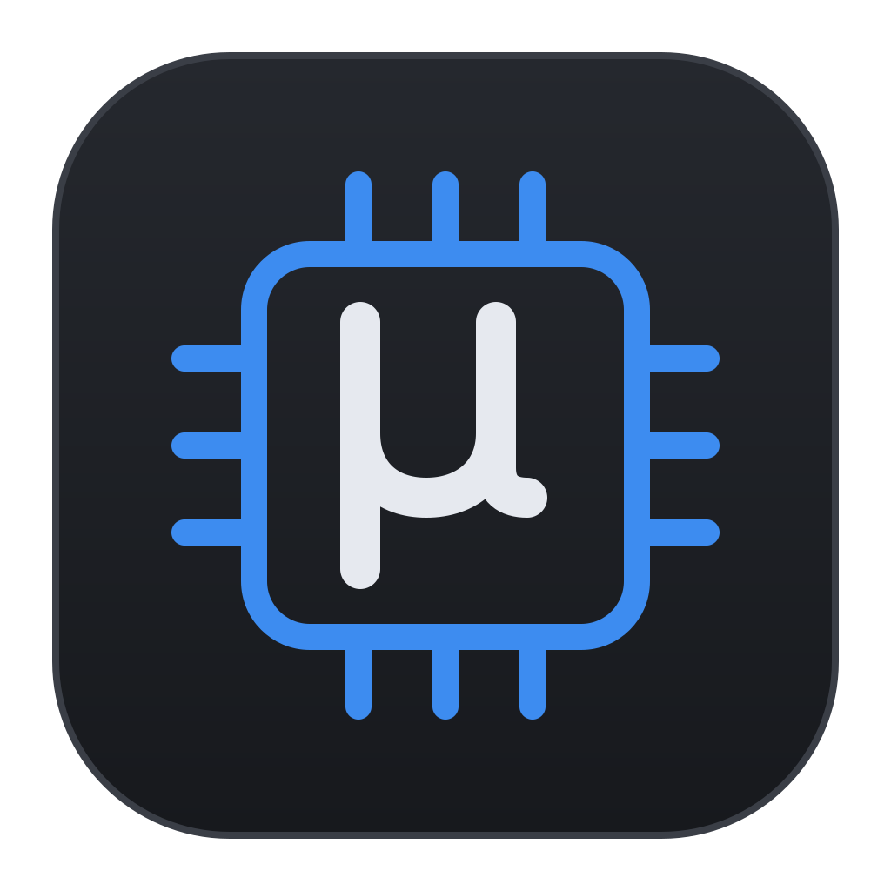
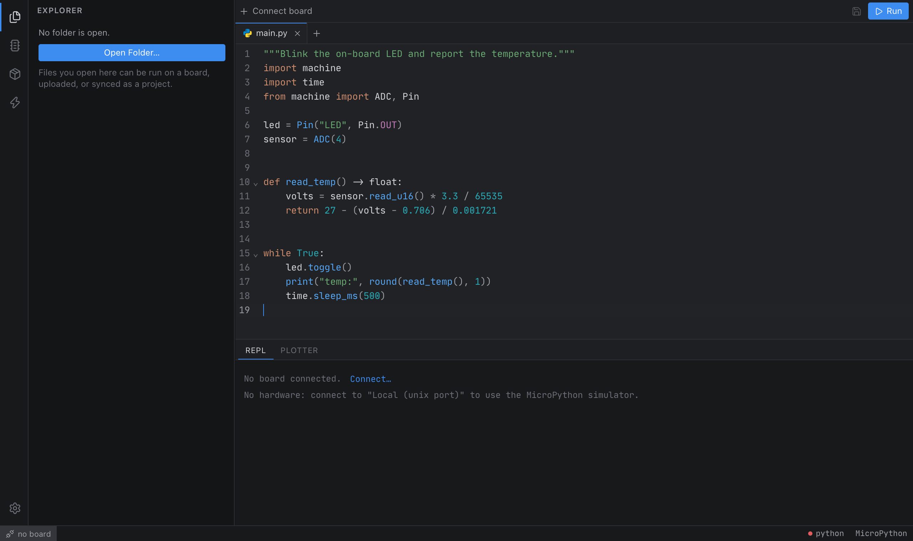

<div align="center">



# Microbe

**A fast, lightweight IDE for MicroPython: every board, every connection, one small native app.**

Tauri 2 · Rust · Svelte 5 · CodeMirror 6 · ty language server



</div>

---

Microbe is a desktop IDE for MicroPython. It talks to your board directly, gives you a real Python language server that knows `machine`, `rp2` and `network`, and flashes firmware for you. It is built on Tauri instead of Electron, so it uses the operating system's webview and a Rust core rather than shipping a browser.

## Features

| | |
|---|---|
| **Every connection** | USB serial, WebREPL over Wi‑Fi, Bluetooth LE (Nordic UART), raw TCP, Telnet (with login), RFC 2217 network serial (remote baud rate and reset lines), and a local simulator that runs the MicroPython unix port in a PTY. |
| **Every port** | rp2, esp32, esp8266, stm32, samd, nrf, mimxrt, renesas‑ra and unix are described by small TOML profiles. Adding a port is one file, with no code change. |
| **Real code intelligence** | [ty](https://github.com/astral-sh/ty) runs as a bundled sidecar. Stubs matching the connected board's port, board and firmware version are downloaded and merged into a custom typeshed, so CPython-only APIs are flagged as errors. Modules the published stubs don't know (custom firmware, `ulab`, C modules) get stubs generated by introspecting the board. |
| **MicroPython checks** | A tree-sitter analysis engine flags CPython-only modules with the MicroPython replacement (`threading` → `_thread`/`asyncio`, `RPi.GPIO` → `machine.Pin`), syntax MicroPython rejects (`match`, `except*`), and pin numbers the connected board doesn't have, can't drive, or wires to flash or the radio. False "undefined name" errors inside `@rp2.asm_pio`, inline assembler and viper functions are hidden. |
| **Run & REPL** | Run the current file with streaming output and `input()` support, then stop it with ⌘. It uses raw‑paste mode with a fallback to plain raw REPL, and an xterm.js terminal per board. |
| **Files** | Project and board explorers with inline create, rename and delete. Project sync uploads only files whose SHA‑256 changed. Binary-safe transfer, and WebREPL's native file protocol when available. |
| **Firmware** | Detects the board (running MicroPython, a UF2 boot drive, the ESP ROM bootloader, or its USB id), fetches the right build from micropython.org, and flashes with espflash, esptool, UF2 copy or dfu‑util. It offers updates when you connect a board running older firmware. ESP32 boards show their partition table and can be updated over the air through any connection. Firmware can also be built from source in Docker, with your project's modules frozen in and your own C modules. |
| **Packages** | Search micropython‑lib and install with `mip` on the host side, so it works on boards without networking. `github:`/`gitlab:` URLs and `.mpy` builds are supported. |
| **Debugger** | Breakpoints, stepping (over, into, out), pause, call stack, locals and globals, and expression evaluation, all on stock firmware. The file is instrumented on the host, so no `sys.settrace` is needed and tracebacks keep their line numbers. |
| **Tests** | `test_*.py` files with `test_*` functions or `Test*` / `TestCase` classes (async too) run on the board, with results per test, failure messages and tracebacks. |
| **Memory & tasks** | A heap block map with fragmentation figures, heap use sampled while a program runs, and a live view of asyncio tasks (sleeping, waiting, failed). |
| **Plotter** | Plot `print(a, b)` or `label:value` lines live, with the raw feed alongside and CSV export. |
| **Several boards at once** | Each board has its own terminal, file tree and session. |
| **Rescue & reconnect** | Break into a runaway `main.py` (reset, then interrupt during boot, optionally disabling `main.py`), get told when a board stops answering, and reconnect automatically when a board re-enumerates. |
| **MCP server for AI agents** | Opt-in. Agents such as Claude Code list boards, run code, read output, and manage files through the same sessions you see. It is served on 127.0.0.1 only, behind a bearer token, with a read-only mode. |

## Getting started

### Prerequisites

- **Rust 1.88+** and **Node 22+**
- Platform prerequisites for Tauri ([guide](https://v2.tauri.app/start/prerequisites/))
- Optional: `brew install micropython` (or your distro's package) for the simulator and the end‑to‑end tests
- Linux: add yourself to the `dialout` group for serial access; BlueZ is needed for BLE

### Run it

```sh
npm install
npm run sidecars        # downloads the ty language server for your platform
npm run tauri dev       # builds the Rust core and opens the app
```

No board? Open the connect dialog (⌘K) and choose **Local (unix port)** to run code in the MicroPython simulator.

### Build a release

```sh
npm run tauri build     # .app / .dmg on macOS, .msi on Windows, .deb/.AppImage on Linux
```

CI builds all platforms ([`.github/workflows/build.yml`](.github/workflows/build.yml)). To release, bump `version` in `package.json`, `src-tauri/Cargo.toml` and `src-tauri/tauri.conf.json`, then push to `main`. CI builds Linux, Windows and macOS (Apple Silicon and Intel) installers and publishes them as release `v<version>`. Pushes that don't change the version build nothing. Running the workflow by hand builds the installers as artifacts without publishing.

Installer names don't include the version, so these links always point at the latest release:

| Platform | Link |
|---|---|
| macOS (Apple Silicon) | https://github.com/mikayelgr/microbe/releases/latest/download/microbe-macos-arm64.dmg |
| macOS (Intel) | https://github.com/mikayelgr/microbe/releases/latest/download/microbe-macos-x64.dmg |
| Windows x64 | https://github.com/mikayelgr/microbe/releases/latest/download/microbe-windows-x64-setup.exe (or `microbe-windows-x64.msi`) |
| Linux x64 | https://github.com/mikayelgr/microbe/releases/latest/download/microbe-linux-x64.AppImage (or `.deb`, `.rpm`) |
| Checksums | https://github.com/mikayelgr/microbe/releases/latest/download/SHA256SUMS.txt |

## Keyboard shortcuts

| Action | Shortcut |
|---|---|
| Connect a board | ⌘K |
| Run the current file | ⌘↵ / F5 |
| Stop the program | ⌘. / ⇧F5 |
| Debug the current file | F6 |
| Continue / step over / step into / step out (debugging) | F8 / F10 / F11 / ⇧F11 |
| Save | ⌘S |
| Toggle the sidebar | ⌘B |
| Toggle autocomplete while typing | ⌘⇧Space |
| Show completions | ⌃Space |
| Rename / delete in a file tree | F2 / ⌘⌫ |

On Windows and Linux, use Ctrl instead of ⌘.

## Using Microbe from an AI agent

Turn on **Settings → MCP server**. Microbe then serves the [Model Context Protocol](https://modelcontextprotocol.io) at `http://127.0.0.1:7357/mcp`. **Copy for Claude Code** puts the registration command on the clipboard:

```sh
claude mcp add --transport http microbe http://127.0.0.1:7357/mcp --header "Authorization: Bearer <token>"
```

The tools are `list_boards`, `board_info`, `exec`, `run_program`, `stop_program`, `read_output`, `list_files`, `read_file`, `write_file`, `make_dir`, `delete_path`, `reset` and `check_code`. If you clear **Allow running code and changing files**, only the read-only tools are offered.

## Development

```sh
npm run check           # svelte-check (types + a11y)
npm test                # frontend unit tests (vitest)
npm run test:e2e        # UI tests in WebKit, the macOS app's engine (Playwright)
cd src-tauri && cargo test   # Rust unit tests + end-to-end tests against the unix port
                             # (sessions, debugger, tests, asyncio, OTA, network transports, MCP)
```

Opt-in diagnostics against real hardware and the network:

```sh
cd src-tauri && cargo test --test hardware -- --ignored --nocapture
```

> **macOS note.** Some Command Line Tools releases ship an SDK that their own linker can't read ("unknown architecture arm64e.x1"). `npm run tauri` detects this and switches to an older installed SDK automatically. For plain `cargo` commands, see the workaround in [`AGENTS.md`](AGENTS.md#build-environment).

### Project layout

```
src/                 Svelte frontend
  lib/features/      sidebar panels (files, board, debug, tests, packages, firmware, settings)
  lib/runtime/       live data from running programs (heap, asyncio tasks)
  lib/components/    shared UI (editor, file tree, terminal, dialogs, tooltips…)
  lib/state/         rune-based stores (boards, editor tabs, project, settings…)
  lib/editor/        CodeMirror setup, completion ranking, LSP client, diagnostics
  lib/bindings/      TypeScript types generated from Rust (ts-rs), do not edit
src-tauri/
  src/               Rust core: transports, raw REPL, sessions, files, firmware, LSP bridge, analysis, MCP
  platforms/*.toml   one profile per MicroPython port (including GPIO maps)
  analysis.toml      tables for the MicroPython checks
  builders.toml      Docker recipes for building firmware from source
  quirks.toml        firmware-version protocol quirks
  py/*.py            device-side scripts (templated, overridable per port)
  tests/             end-to-end tests against the MicroPython unix port (sessions, MCP over HTTP)
e2e/                 Playwright UI tests (WebKit, backend stubbed)
docs/                architecture and decision log
```

### Extending Microbe

Most extensions are a single file or a single trait implementation. [`AGENTS.md`](AGENTS.md#extension-recipes) has step‑by‑step recipes for adding a port, transport, flasher, detector, language server, lint rule, MCP tool, firmware build recipe, runtime feature, sidebar feature or icon.

## Documentation

- [`docs/ARCHITECTURE.md`](docs/ARCHITECTURE.md): how the pieces fit together
- [`docs/DECISIONS.md`](docs/DECISIONS.md): why things are the way they are
- [`AGENTS.md`](AGENTS.md): conventions and recipes for contributors and coding agents

## Credits

Microbe builds on [Tauri](https://tauri.app), [CodeMirror](https://codemirror.net), [xterm.js](https://xtermjs.org), [uPlot](https://github.com/leeoniya/uPlot), [ty](https://github.com/astral-sh/ty), [espflash](https://github.com/esp-rs/espflash), [micropython-stubs](https://github.com/Josverl/micropython-stubs), [Lucide](https://lucide.dev) and the [Material Icon Theme](https://github.com/material-extensions/vscode-material-icon-theme). Protocol behaviour follows MicroPython's own `mpremote`.
